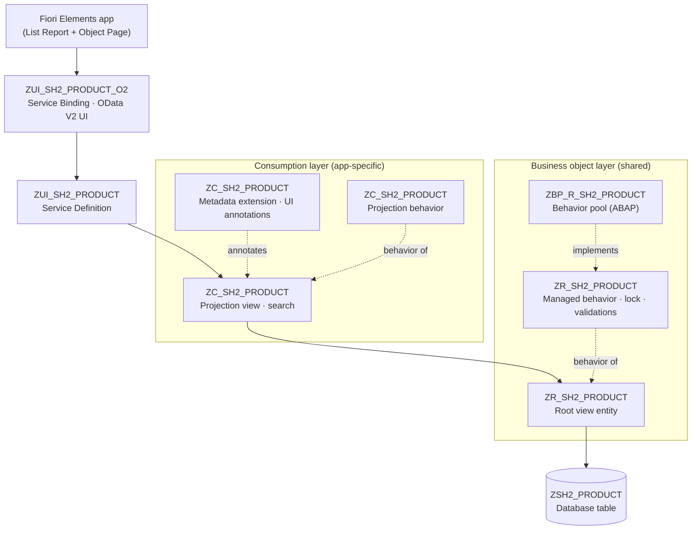

# Matcha Mug – SAP ABAP Cloud Inventory App

An end-to-end inventory application for a small online tea shop, built on the **SAP BTP ABAP Environment** with **ABAP Cloud**, **Core Data Services (CDS)**, the **ABAP RESTful Application Programming Model (RAP)**, and **SAP Fiori Elements**.

I started this self-directed portfolio project while moving from full-stack web development into SAP. It goes all the way from a database table to a working Fiori app, and every object and commit is linked to a written requirement.

> **Status:** in progress, target completion January 2027. See [Roadmap](#roadmap).

---

## What the app does

- Lists all products in a Fiori Elements List Report, with a search box and filter fields
- Opens each product in an Object Page
- Lets the shop manager create, edit, and delete products, with record locking
- Rejects invalid data (price ≤ 0, negative stock) and shows field-level error messages
- Processes sales orders in ABAP, checking stock availability and rejecting unknown products

## Architecture



| Layer | Object | Type | Purpose |
|---|---|---|---|
| Data | `ZSH2_PRODUCT` | Database table | Product master: ID, name, price, currency, stock |
| BO | `ZR_SH2_PRODUCT` | CDS root view entity | Business object data model and field labels |
| BO | `ZR_SH2_PRODUCT` | Behavior definition (managed) | Create, update, delete, locking, read-only key, validations, field mapping |
| BO | `ZBP_R_SH2_PRODUCT` | ABAP class (behavior pool) | Validation logic for price and stock |
| App | `ZC_SH2_PRODUCT` | CDS projection view | App-specific view with free-text search |
| App | `ZC_SH2_PRODUCT` | Metadata extension | List columns, Object Page layout, filter fields |
| App | `ZC_SH2_PRODUCT` | Behavior definition (projection) | Chooses which operations the app exposes |
| Service | `ZUI_SH2_PRODUCT` | Service definition | Exposes the projection as `Product` |
| Service | `ZUI_SH2_PRODUCT_O2` | Service binding | OData V2 UI service used by Fiori Elements |
| Reporting | `ZI_SH2_PRODUCT` | CDS view entity | Calculated stock status (Out of stock / Low stock / In stock) |
| Logic | `ZCL_SH2_SALE` | ABAP class | Sales order processing with ABAP SQL |
| Tooling | `ZCL_SH2_PRODUCTS`, `ZCL_SH2_PRODUCT_VIEW` | ABAP classes | Seed test data and check results in the console |

## Requirements traceability

The project follows a short specification of 9 functional requirements (FR), 7 business rules (BR), and 9 acceptance criteria (AC). Every commit message starts with the requirement ID it delivers.

| ID | Requirement | Implemented in | Status |
|---|---|---|---|
| FR-01 | Store product data permanently | `ZSH2_PRODUCT` | ✅ |
| FR-02 | Process sales orders and report each line | `ZCL_SH2_SALE` | ✅ |
| FR-03 | List all products in the app | `ZC_SH2_PRODUCT` + metadata extension | ✅ |
| FR-04 | Search by product ID or name | `@Search` annotations on `ZC_SH2_PRODUCT` | ✅ |
| FR-05 | Open product details | Object Page facets | ✅ |
| FR-06–08 | Create, edit, and delete products in the app | Managed RAP behavior | ✅ |
| FR-09 | Highlight products with stock below 10 | Stock status in `ZI_SH2_PRODUCT`; UI highlight planned | 🟡 |
| BR-01 | Product ID must be unique | Table key + `readonly : update` | ✅ (AC-06 test planned) |
| BR-02 | Price must be greater than 0 | RAP validation `validatePrice` | ✅ |
| BR-03 | Stock must not be negative | RAP validation `validateStock` | ✅ |
| BR-04 | Cannot sell more than available stock | `ZCL_SH2_SALE` | ✅ |
| BR-05 | Unknown product: warn and change nothing | `ZCL_SH2_SALE` | ✅ |
| BR-06 | Never delete sold-out products automatically | `ZCL_SH2_SALE` still has a practice `DELETE` | ⚠️ Known issue, fix planned |
| BR-07 | All prices in AUD | Seed data | 🟡 Not yet enforced in the app |

## Implementation highlights

**Validation triggers.** Each validation runs only when it is needed: on create, or when its own field changes.

```abap
validation validatePrice on save { create; field Price; }
validation validateStock on save { create; field Stock; }
```

**Reading pending changes.** Validations read data with EML from the transactional buffer, because new values have not reached the database yet. Failed records stop the save, and messages are linked to the field.

```abap
READ ENTITIES OF zr_sh2_product IN LOCAL MODE
  ENTITY Product FIELDS ( Price ) WITH CORRESPONDING #( keys )
  RESULT DATA(products).

LOOP AT products INTO DATA(product).
  IF product-Price <= 0.
    APPEND VALUE #( %tky = product-%tky ) TO failed-product.
    APPEND VALUE #( %tky = product-%tky
                    %msg = new_message_with_text( severity = if_abap_behv_message=>severity-error
                                                  text     = 'Price must be greater than 0' )
                    %element-Price = if_abap_behv=>mk-on ) TO reported-product.
  ENDIF.
ENDLOOP.
```

**Layered model.** The shared business object (`ZR_`) owns the data and rules. The app layer (`ZC_`) only selects fields and operations, so another app could, for example, hide Delete without changing the business object.

## Problems I solved along the way

- **No Create/Edit/Delete buttons on OData V4.** A non-draft business object showed data but no action buttons on a V4 UI binding. I switched to an OData V2 UI binding for now and plan to return to V4 when draft is added.
- **Empty field labels in the form.** The table uses built-in types without data elements, so there were no labels. I added `@EndUserText.label` to the root view, and the projection inherits it.
- **Search only matched full names.** Searching "Mug" did not find "Matcha Mug" until I added `@Search.fuzzinessThreshold`.
- **Quick fix failed with HTTP 500 on the trial system.** I created the behavior pool class by hand (`FOR BEHAVIOR OF`) and activated it together with the behavior definition.

## How to run

1. Create an SAP BTP ABAP Environment trial and connect Eclipse with ABAP Development Tools.
2. Create a package, then link and pull this repository with the abapGit plugin.
3. Activate all objects (`Ctrl+Shift+F3`).
4. Run `ZCL_SH2_PRODUCTS` (F9) to load six sample products.
5. Open `ZUI_SH2_PRODUCT_O2`, click **Publish**, select `Product`, and click **Preview**.

> Object names use the suffix `SH2` because the trial system is shared with other users.

## Roadmap

- [ ] Highlight low-stock products in the list (FR-09)
- [ ] Test duplicate product IDs in the app (AC-06)
- [ ] Add draft handling and move to an OData V4 UI service
- [ ] Remove the automatic delete in `ZCL_SH2_SALE` (BR-06)
- [ ] Add screenshots of the finished app

## Tech stack

ABAP Cloud · ABAP SQL · CDS view entities · RAP (managed, projection, validations, EML) · OData V2 · SAP Fiori Elements · SAP BTP ABAP Environment · Eclipse ADT · abapGit
